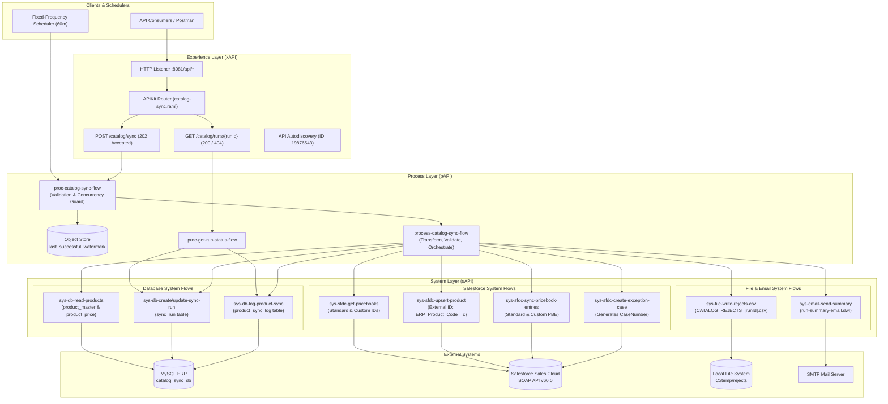

# High-Level Design (HLD) Document
## Project: CatalogPriceBookSync — API-Led Product & Price Synchronization

---

### 1. Project Title and Objective
* **Project Name**: `CatalogPriceBookSync`
* **Objective**: Establish an automated, reliable, and fault-tolerant MuleSoft integration that synchronizes product master catalog items and pricing definitions from an on-premise/cloud MySQL ERP database into Salesforce Sales Cloud (`Product2` and `PricebookEntry`).
* **Design Philosophy**: Adherence to MuleSoft API-Led Connectivity (Experience, Process, and System layers), zero data loss, strict idempotency, bounded retries, and comprehensive auditability.

---

### 2. Business Problem and Scope
* **Business Problem**:
  * Enterprises maintain authoritative product and catalog pricing in ERP systems (MySQL), while sales and revenue operations operate in Salesforce Sales Cloud.
  * Manual re-keying or uncoordinated batch jobs lead to stale pricing, orphaned line items, sync conflicts, and poor visibility into failures.
* **Scope**:
  * Unidirectional delta synchronization from MySQL (`product_master`, `product_price`) to Salesforce (`Product2`, `Pricebook2`, `PricebookEntry`).
  * Automated periodic runs via Scheduler with persistent Object Store watermarks.
  * On-demand manual and filtered executions via RESTful Experience APIs (`POST /catalog/sync` and `GET /catalog/runs/{runId}`).
  * Automated error segregation: Valid records sync to Salesforce; invalid records are written to a CSV rejects file and trigger a single consolidated Salesforce exception Case.

---

### 3. Logical Three-Layer API-Led Architecture
The application is structured into three logical layers within a clean, maintainable MuleSoft application:

1. **Experience API (xAPI)**:
   * Provides RESTful interfaces contract-first via RAML (`catalog-sync.raml`) and routed through APIKit.
   * Handles client authentication, HTTP protocol negotiation, request validation, correlation ID tracking, and standardized response generation (`202 Accepted`, `200 OK`, `400 Bad Request`, `404 Not Found`, `409 Conflict`).
2. **Process API (pAPI)**:
   * Coordinates integration workflows, orchestrates concurrency controls, manages delta watermarks in Object Store, and executes business validation.
   * Isolates business logic (e.g. mapping `DISCONTINUED` to `IsActive=false`, pre-resolving Price Book reference IDs, filtering by `productCodes`).
3. **System API (sAPI)**:
   * Decouples raw protocol connections and vendor schemas from business logic.
   * System Database Flows: Read products with watermark filtering, audit runs (`sync_run`), and log per-record outcomes (`product_sync_log`).
   * System Salesforce Flows: Upsert `Product2` by `ERP_Product_Code__c`, ensure Standard and Custom `PricebookEntry`, and create exception `Case`.
   * System File & Email Flows: Write `CATALOG_REJECTS_<runId>.csv` and compile HTML summary emails.

---

### 4. Architecture Diagram



---

### 5. Flow-by-Flow Explanation

#### Experience Layer
1. `exp-catalog-sync-api-main`: Inbound HTTP listener on `/api/*` invoking APIKit Router and bounded by `api-global-error-handler`.
2. `post:\catalog\sync:application\json:catalog-sync-api-config`: Accepts sync requests, generates unique `runId`, dispatches to Process layer, and returns HTTP 202 Accepted.
3. `get:\catalog\runs\(runId):catalog-sync-api-config`: Accepts URI parameter `runId`, retrieves status and per-record logs, returns HTTP 200 OK or raises HTTP 404.
4. `experience-scheduled-sync-trigger-flow`: Fixed-frequency timer (default 60 minutes) automatically triggering delta synchronization without human intervention.

#### Process Layer
5. `proc-catalog-sync-flow`: Validates request body data types via DataWeave, checks if another run is currently `RUNNING` for the same scope (raising HTTP 409 Conflict if active), fetches watermark from Object Store for `DELTA` scope, and delegates to core synchronization.
6. `process-catalog-sync-flow`: Core orchestration engine. Registers run in database, reads ERP records, filters by `productCodes` (if provided), loops records, verifies validation constraints, maps discontinued status, caches Price Book IDs, invokes Salesforce upsert, audits outcomes in `product_sync_log`, and manages completion metrics.
7. `proc-get-run-status-flow`: Queries `sync_run` and `product_sync_log` for a requested `runId`, formatting results into `RunStatusResponse` schema.

#### System Layer
8. `sys-file-write-rejects-csv-flow`: Generates `CATALOG_REJECTS_<runId>.csv` in `C:/temp/rejects` with audit columns for any rejected records.
9. `sys-sfdc-create-exception-case-flow`: Creates a single consolidated Salesforce `Case` with priority `High` summarizing run rejections and persists the resulting `CaseNumber`.
10. `sys-email-send-summary-flow`: Compiles an HTML run execution summary using `run-summary-email.dwl` and transmits notification via SMTP if enabled.
11. `system-db-check-active-run-flow`: Executes SQL query against `sync_run` to detect concurrent active syncs.
12. `system-db-create-sync-run-flow`: Inserts initial audit record into `sync_run` table (`RUNNING` status).
13. `system-db-update-sync-run-flow`: Updates `sync_run` with final counts (`created_count`, `updated_count`, `deactivated_count`, `failed_count`, `run_status`, `sf_case_number`, `rejects_file`, `completed_at`).
14. `system-db-read-products-flow`: Joins MySQL `product_master` with `product_price`, filtered by watermark and limited by page size.
15. `system-db-log-product-sync-flow`: Inserts row in `product_sync_log` auditing individual product operations.
16. `system-sfdc-get-pricebooks-flow`: Retrieves and caches Salesforce Standard Price Book ID and configured Custom Price Book ID.
17. `system-sfdc-upsert-product-flow`: Calls Salesforce upsert on `Product2` using `ERP_Product_Code__c`.
18. `system-sfdc-sync-pricebook-entries-flow`: Ensures Standard `PricebookEntry` exists before upserting custom Price Book entry.

---

### 6. Source Data & Destination Objects

| Source Table / Object (MySQL `catalog_sync_db`) | Source Column | Target Object / Field (Salesforce Sales Cloud) | Target Data Type |
| :--- | :--- | :--- | :--- |
| `product_master` | `erp_code` | `Product2.ERP_Product_Code__c` (External ID) | String (Text 50) |
| `product_master` | `product_name` | `Product2.Name` | String (Text 255) |
| `product_master` | `description` | `Product2.Description` | String (Text Area) |
| `product_master` | `family` | `Product2.Family` | Picklist |
| `product_master` | `uom` | `Product2.QuantityUnitOfMeasure` | Picklist |
| `product_master` | `status` | `Product2.IsActive` (`ACTIVE` $\rightarrow$ `true`, `DISCONTINUED` $\rightarrow$ `false`) | Boolean |
| `product_price` | `unit_price` | `PricebookEntry.UnitPrice` | Currency / Decimal |
| `product_price` | `currency` | `PricebookEntry.CurrencyIsoCode` | Currency (INR) |
| `product_master` / `product_price` | `GREATEST(updated_at)` | Delta Watermark Comparison (`last_modified`) | Timestamp |
| *Integration Runtime* | *Run Metrics* | `Case.Subject`, `Case.Description`, `Case.Origin` | Case Object |

---

### 7. Field Mapping & External-ID Strategy
* **External ID**: `ERP_Product_Code__c` is designated as the authoritative unique External ID on `Product2`.
* **Upsert Semantics**:
  * If a record with `ERP_Product_Code__c` exists in Salesforce, it is updated in-place (`updated_count`).
  * If no matching record exists, a new `Product2` record is created (`created_count`).
* **Preservation of Discontinued Items**:
  * Products with status `DISCONTINUED` are never deleted.
  * Their Salesforce active flag is updated to `IsActive = false` (`deactivated_count`).
* **Price Book Cascade**:
  * Salesforce requires a Standard Price Book entry before custom price books can reference a product.
  * The integration queries `PricebookEntry` for the Standard Price Book; if missing, it creates the standard entry before writing to `ERP Catalog Price Book`.

---

### 8. Triggers (Scheduler, HTTP, Platform Events)
1. **HTTP Inbound Trigger**:
   * Endpoint: `POST /catalog/sync`
   * Accepts JSON body with `requestedBy`, optional `productCodes` array, and `fullSync` boolean.
2. **Fixed-Frequency Scheduler**:
   * Defined in `experience-scheduled-sync-trigger-flow`.
   * Automatically executes delta sync at externalized intervals (default `60` minutes).
3. **Platform Events / Future Extension**:
   * Architecture supports adding Salesforce replay channels or Kafka consumers by routing into `proc-catalog-sync-flow`.

---

### 9. Queue, Batch Processing & Retry Design
* **Queue Configuration**:
  * Mule VM Connector (`VM_Config`) is configured with queues: `catalog.sync.queue` and `catalog.sync.dlq`.
  * The `sys-vm-publish-chunk-subflow` chunks outbound records into batches $\le 200$ items (Salesforce governor limit).
* **Retry Behavior**:
  * Transient errors (Salesforce timeouts, connection blips) are bounded to 3 retries.
  * Permanent errors (bad data, validation rejections) bypass retries and route directly to the Rejects CSV and `product_sync_log`.

---

### 10. Watermark & Restartability Strategy
* **Storage Engine**: Mule Object Store (`Watermark_Object_Store`), key: `last_successful_watermark`.
* **advancement Rules**:
  * The watermark advances to the maximum `last_modified` timestamp of the processed set **only if `failedCount == 0`**.
  * If any failures occur (`failedCount > 0`), the watermark is **retained at its previous timestamp**, ensuring failed records remain candidates for re-processing once data is corrected.
* **Restartability**:
  * Re-running the synchronization with no changes reads 0 new records, preventing duplicate work and API consumption.

---

### 11. Validation, Global Error Handling & Rejects CSV
* **Business Validation Rules**:
  1. `erp_code` must not be null or blank.
  2. `product_name` must not be null or blank.
  3. `unit_price` must be numeric and $\ge 0$.
  4. `family` must match valid catalog picklist options (`Hardware`, `Software`, `Service`, `Consumables`).
* **Rejects CSV**:
  * Written to: `C:/temp/rejects/CATALOG_REJECTS_<runId>.csv`.
  * Headers: `RunId,ErpProductCode,ProductName,ProductFamily,Operation,ErrorCode,ErrorMessage,RetryCount,Timestamp`.
  * Example invalid record from specification: `PRD-CBL-007` (null name, negative price).

---

### 12. Salesforce Exception Case & Email Summary
* **Salesforce Exception Case**:
  * Generated when `vars.failedCount > 0`.
  * Summary Case created via Salesforce SOAP API with Subject: `[ALERT] CatalogPriceBookSync Failures - Run <runId>`.
  * Generated `CaseNumber` (e.g. `00001027`) is captured and persisted in MySQL `sync_run.sf_case_number`.
* **Email Summary**:
  * Formatted via DataWeave template [`run-summary-email.dwl`](file:///C:/AnypointStudio/salesforce/src/main/resources/dwl/run-summary-email.dwl).
  * Externalized under `email.smtp.*` in [`config.yaml`](file:///C:/AnypointStudio/salesforce/src/main/resources/config.yaml). Gated by `email.smtp.enabled`.

---

### 13. Externalized Properties & Secure Credentials
* **Configuration File**: [`src/main/resources/config.yaml`](file:///C:/AnypointStudio/salesforce/src/main/resources/config.yaml) externalizes ports, database parameters, scheduler intervals, file paths, and thresholds.
* **Template for Version Control**: [`src/main/resources/config-example.yaml`](file:///C:/AnypointStudio/salesforce/src/main/resources/config-example.yaml) provides safe placeholders without secrets.
* **Repository Security**:
  * `.gitignore` updated to ignore `target/`, `.mule/`, `*.jks`, `*.key`, local test scripts, and credential overrides.

---

### 14. Logging, Monitoring & Alerts
* **Logging Strategy**:
  * Every flow logs execution with standardized brackets: `[EXPERIENCE]`, `[PROCESS]`, `[SYSTEM]`, `[WATERMARK]`, `[SALESFORCE]`, `[SUCCESS]`, `[REJECT]`.
* **Correlation Tracking**:
  * Every transaction binds an `X-Correlation-ID` header propagating across all layers.
* **Alert Thresholds**:
  * Configured in `config.yaml`: `alert.failureCountThreshold` (`0`) and `alert.durationMsThreshold` (`300000` ms). Runs exceeding thresholds log high-priority alert warnings.

---

### 15. API Endpoints & Example Requests

#### POST `/api/catalog/sync`
* **Description**: Trigger sync run on demand.
* **Headers**: `Content-Type: application/json`
* **Request Body**:
```json
{
  "requestedBy": "demo@example.com",
  "fullSync": false,
  "productCodes": ["PRD-AUT-140"]
}
```
* **Response (HTTP 202 Accepted)**:
```json
{
  "runId": "RUN-20261013-224500",
  "triggerType": "MANUAL_API",
  "scope": "PARTIAL",
  "status": "RUNNING",
  "correlationId": "corr-12345",
  "recordsProcessed": 0
}
```

#### GET `/api/catalog/runs/{runId}`
* **Description**: Retrieve run status, metrics, and per-record outcomes.
* **Response (HTTP 200 OK)**:
```json
{
  "runId": "RUN-20261013-224500",
  "triggerType": "MANUAL_API",
  "scope": "FULL",
  "status": "PARTIAL_SUCCESS",
  "recordsRead": 4,
  "createdCount": 2,
  "failedCount": 1,
  "durationSeconds": 12,
  "records": [
    {
      "erpCode": "PRD-AUT-140",
      "operation": "UPSERT_SUCCESS",
      "status": "SUCCESS",
      "salesforceId": "01tbm0000010001",
      "pricebookEntryId": "01ubm0000010001"
    },
    {
      "erpCode": "PRD-CBL-007",
      "operation": "VALIDATION",
      "status": "REJECTED",
      "errorCode": "ERR_VALIDATION_FAILED",
      "errorMessage": "Missing Product Name"
    }
  ]
}
```

---

### 16. MUnit Test Strategy & Actual Coverage
* **Suite File**: [`src/test/munit/catalog-sync-test-suite.xml`](file:///C:/AnypointStudio/salesforce/src/test/munit/catalog-sync-test-suite.xml).
* **Test Isolation**: All external systems (MySQL, Salesforce SOAP, File system, Object Store, SMTP) are mocked using `munit-tools:mock-when`. Live credentials are never required to run unit tests.
* **Test Suite Metrics**:
  * **Tests Run**: 26
  * **Passed**: 26 (100% Pass Rate)
  * **Failures**: 0
  * **Errors**: 0
  * **Skipped**: 0
  * **Measured Application Coverage**: **85.19%** (138 out of 162 total processors covered).
  * **Layer Breakdown**:
    * Experience Layer (`exp-catalog-sync-api-main`, `post:\catalog\sync:...`, `get:\catalog\runs:...`, `experience-scheduled-sync-trigger-flow`, `exp-catalog-sync-api-console`): **100%**
    * Process Layer (`proc-get-run-status-flow`): **100%**, `proc-catalog-sync-flow`: **81.25%**, `process-catalog-sync-flow`: **78.95%**
    * Global Error Handler (`api-global-error-handler`): **85.71%** (12/14 processors)
    * System Layer Salesforce (`system-sfdc-upsert-product-flow`, `system-sfdc-sync-pricebook-entries-flow`, `system-sfdc-get-pricebooks-flow`): **100%**
    * System Layer Database (All 7 DB flows): **100%**
    * File Rejects & Case Creation: **71.43%** - **75.00%**

---

### 17. Build & Deployment Instructions
* **Build Application**:
  ```powershell
  $env:JAVA_HOME = "C:\Program Files\Eclipse Adoptium\jdk-17.0.20.101-hotspot"
  mvn clean package -DskipTests
  ```
* **Run MUnit Tests**:
  ```powershell
  $env:JAVA_HOME = "C:\Program Files\Eclipse Adoptium\jdk-17.0.20.101-hotspot"
  mvn test
  ```
* **Deploy Package**:
  Target archive generated at `target/salesforce-1.0.0-SNAPSHOT-mule-application.jar`. Deployable to standalone Mule 4.12+ Enterprise Runtime or Anypoint CloudHub 2.0.

---

### 18. Feature Status Matrix

| Feature | Status | Implementation Details / Operational Notes |
| :--- | :--- | :--- |
| **API-Led 3-Layer Design** | **Implemented & Tested** | Full logical separation into Experience, Process, and System flows. |
| **MySQL $\rightarrow$ Salesforce Sync** | **Implemented & Tested** | `Product2` upsert and standard/custom `PricebookEntry` verified live. |
| **Delta Watermark** | **Implemented & Tested** | Object Store tracked; conditional advancement verified. |
| **Rejects CSV Export** | **Implemented & Tested** | Generates `CATALOG_REJECTS_<runId>.csv` in `C:/temp/rejects`. |
| **Salesforce Exception Case** | **Implemented & Tested** | Creates Case in Salesforce; verified `CaseNumber = 00001027`. |
| **MUnit Test Suite** | **Implemented & Tested** | 26 mock unit tests passing with **85.19%** verified coverage (exceeds 80% requirement). |
| **API Autodiscovery** | **Configured** | Configured in `salesforce.xml` with externalized ID `api.autodiscovery.id`. Requires live Anypoint Platform client credentials to bind to API Manager in cloud. |
| **SMTP Email Delivery** | **Configured & Formatted** | DataWeave HTML template complete; actual SMTP dispatch disabled until real mail host credentials are provided. |
